# AI 销售云创工作台

**YunChuang AI SaaS Platform** · 面向传统行业销售团队的多租户 AI SaaS 产品

## 01. Project Overview

AI 销售云创工作台面向传统行业企业及其销售团队，将企业知识库、RAG、AI 销售助手、行业洞察和内容分享整合到日常销售流程中。

产品围绕企业知识分散、销售沟通准备耗时、客户跟进内容不足等问题，提供从知识获取、沟通辅助到内容生成、微信分享及访问反馈的业务闭环。微信小程序服务销售人员，Platform Admin 服务平台运营和管理人员，两个入口共同支撑多租户业务。

这是已落地运行的产品工程展示，覆盖业务应用、AI 能力集成和基础设施实践。本仓库是 GitHub Showcase，不包含完整商业产品源码。

## 02. Core Features

| 业务能力                           | 用途                        |
| ------------------------------ | ------------------------- |
| Enterprise Knowledge Base      | 集中管理企业知识，为销售问答提供可检索的知识依据。 |
| AI Sales Assistant             | 结合企业知识辅助销售人员获取信息和准备客户沟通。  |
| Sales Communication & Strategy | 为销售沟通、客户跟进和策略准备提供辅助建议。    |
| Compliance Checking            | 辅助检查销售内容的合规风险，供使用者复核。     |
| Industry Insights              | 提供行业信息，支持销售人员了解客户所在行业。    |
| Public Content Generation      | 生成适合对外传播的内容，并衔接发布流程。      |
| WeChat Moments Sharing         | 将公开内容分享至微信朋友圈，承接访问反馈。     |
| Enterprise Data & Analytics    | 汇总内容访问等业务数据，支持企业查看使用反馈。   |
| Multi-Tenant Administration    | 管理租户、权限边界及租户级 AI 配置。      |

## 03. System Architecture & Integration

产品由多个独立技术系统集成组成。原生微信小程序与 Next.js 管理端是两个业务入口，共用一个 Tencent CloudBase 业务数据环境；管理端的管理员认证另有独立 SQLite 存储。

### System Architecture

下图按六层展示系统职责。橙色边界突出贯穿业务服务、数据访问及租户级 AI 资源的治理机制，不代表新增微服务。实线表示已确认的集成关系，灰色虚线仅表示能力关联；模型与运行服务之间不推定具体调用路径。

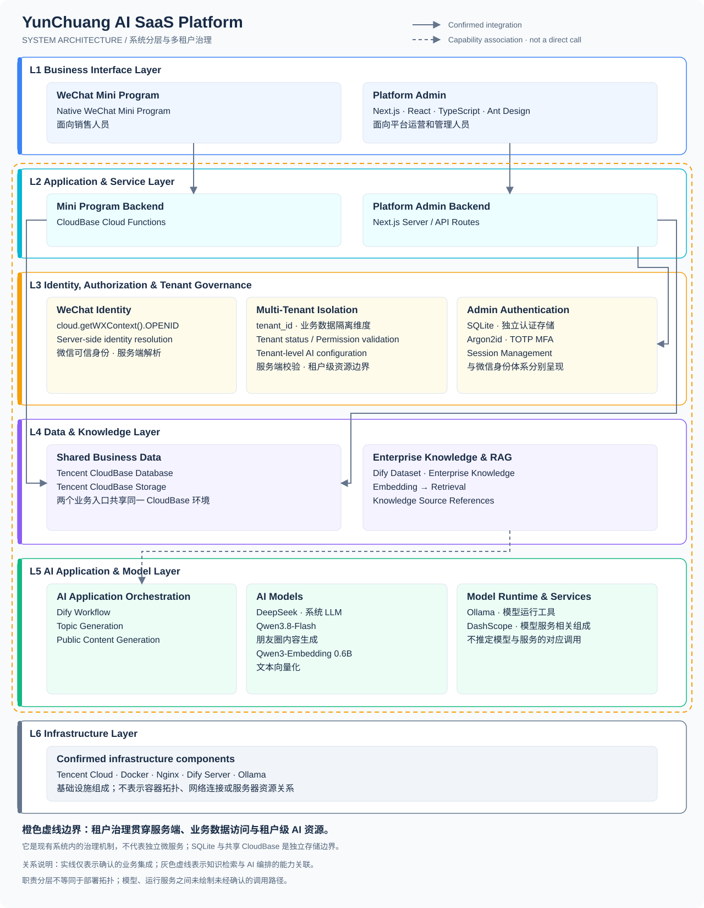

图中文字较多，移动端建议点击图片查看原图。

**基础设施**：腾讯云服务器已部署 Docker、Dify、Ollama、Qwen3-Embedding 0.6B 及 Nginx。上述部署事实与 AI 能力分层分别描述；具体容器划分、网络拓扑及模型调用路径不在图中推定。

关键集成链路：

- **WeChat Mini Program → CloudBase**：小程序通过云函数承接服务端业务处理，使用共享环境中的业务数据与文件能力。
- **Platform Admin → CloudBase**：管理端通过 Next.js Server / API Routes 接入同一 CloudBase 环境；独立管理员认证存储与共享业务数据环境分开。
- **AI Application → Dify / LLM / Embedding**：Dify 承担 Workflow 和 Dataset / RAG 能力；DeepSeek 是系统使用的 LLM，Qwen3.8-Flash 用于朋友圈内容生成，Qwen3-Embedding 0.6B 用于文本向量化。Ollama 提供模型运行能力，DashScope 是模型服务相关组成；具体模型与服务的对应关系不作推定。
- **Public Content → Generation → Publishing → WeChat Sharing → Analytics**：连接内容生产、公开传播与企业统计，完整链路如下。

### Stage9 — AI-Powered Public Content Lifecycle

以下十阶段业务链路已完成生产验收。实线表示业务顺序，虚线连接对应工程能力说明。

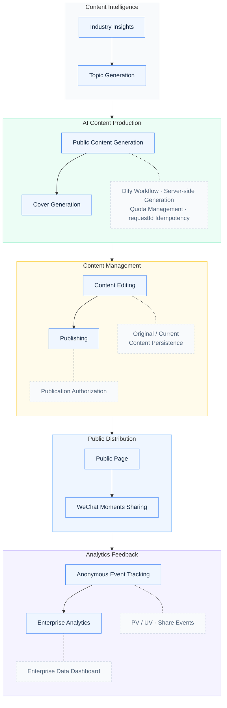

从行业洞察出发，完成选题、正文和封面生成，经编辑与发布形成公开页面；微信分享后的匿名事件回流至企业分析，支持 PV / UV 与分享统计。该链路已完成生产闭环，朋友圈分享回流已验收。

## 04. Technical Highlights

**1. Multi-Tenant SaaS Architecture**

以 `tenant_id` 作为业务数据隔离维度，将业务资源访问与租户权限边界关联。租户级 AI 配置支持不同企业使用各自的知识与 AI 能力配置，服务端负责校验访问范围。

**2. Secure Identity & Authorization**

微信身份采用 `cloud.getWXContext().OPENID` 这一服务端可信来源，结合服务端身份解析、权限校验和 Tenant 状态检查，共同约束业务访问范围，避免仅依赖客户端提供的身份与权限信息。

**3. Enterprise Knowledge & RAG**

企业知识通过 Dify Dataset 接入知识库链路，Embedding 模型完成文本向量化，Dify 知识库链路承担 RAG 检索，并提供检索结果及知识来源引用。

**4. AI Workflow & Content Generation**

通过 Dify Workflow 组织 Topic Generation 与 Public Content Generation，由服务端控制生成流程。Qwen3.8-Flash 用于朋友圈内容生成，生成结果进入封面生成、内容编辑和发布等业务环节。

**5. Public Content & Social Sharing**

公开内容采用 Original / Current 双模型，区分原始内容与当前内容；以 `requestId` 幂等约束重复请求，由服务端管理 quota。发布权限与公开读取权限分别控制内容操作和公开访问，衔接公开页面、微信分享、匿名事件回流以及 PV / UV 与分享统计。

**6. Asynchronous File Processing & State Management**

围绕文件上传、异步处理及 Dify 文件同步跟踪任务状态，在多任务并发场景下管理各任务的状态流转，并支持失败识别与任务恢复。这一机制关注文件处理生命周期，与内容生成请求的 `requestId` 幂等分别承担不同职责。

**7. Platform Administration & Engineering**

Platform Admin 使用独立管理员认证，包含 Argon2id、TOTP MFA 和 Session 管理；业务代码采用 API / Service / Repository 分层，并使用自动化测试进行验证。分层结构便于组织权限、业务规则和数据访问逻辑的测试。

## 05. Technology Stack

下表描述整个产品的技术组成，并标明业务入口或使用范围。两个业务入口分别开发，本 Showcase 仓库不承载它们的完整实现；技术组成不等同于某一个仓库的依赖列表。

| 类别                       | 技术                                                             | 所属入口或使用范围                                       |
| ------------------------ | -------------------------------------------------------------- | ----------------------------------------------- |
| Frontend                 | Native WeChat Mini Program                                     | 微信小程序入口                                         |
| Frontend                 | Next.js、React、TypeScript、Ant Design                            | Platform Admin 入口                               |
| Backend                  | CloudBase Cloud Functions、CloudBase Database、CloudBase Storage | 小程序业务服务及共享业务数据、文件环境                             |
| Backend                  | Next.js API Routes                                             | Platform Admin 服务端，接入共享 CloudBase 环境            |
| AI Application & RAG     | Dify                                                           | Workflow 编排、Dataset 与 RAG 检索链路                  |
| AI Models                | DeepSeek、Qwen3.8-Flash                                         | 系统 LLM；其中 Qwen3.8-Flash 用于朋友圈内容生成               |
| Embedding Model          | Qwen3-Embedding 0.6B                                           | 文本向量化                                           |
| Model Runtime & Services | Ollama、DashScope                                               | 分别为模型运行工具、模型服务相关组成                              |
| Infrastructure           | Tencent Cloud、Docker、Nginx                                     | 腾讯云服务器部署 Docker、Dify、Ollama、Embedding 模型及 Nginx |
| Testing & Engineering    | Jest                                                           | 微信小程序端测试                                        |
| Testing & Engineering    | Vitest                                                         | Platform Admin 测试                               |
| Testing & Engineering    | Git                                                            | 产品版本管理                                          |

管理端另使用 SQLite 存储独立管理员认证数据，详见架构章节。

## 06. Product Screenshots

### WeChat Mini Program

知识获取、AI 问答、行业洞察与朋友圈内容创作。移动端截图保留原始纵横比。

**Product Home & Enterprise Knowledge Base**

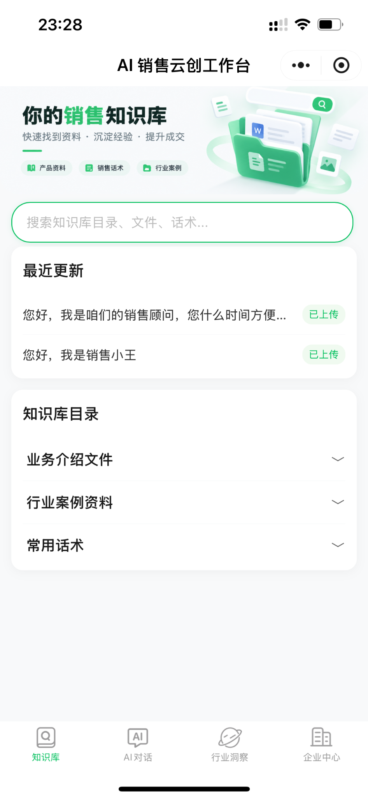

**AI Sales Assistant · 知识来源引用**

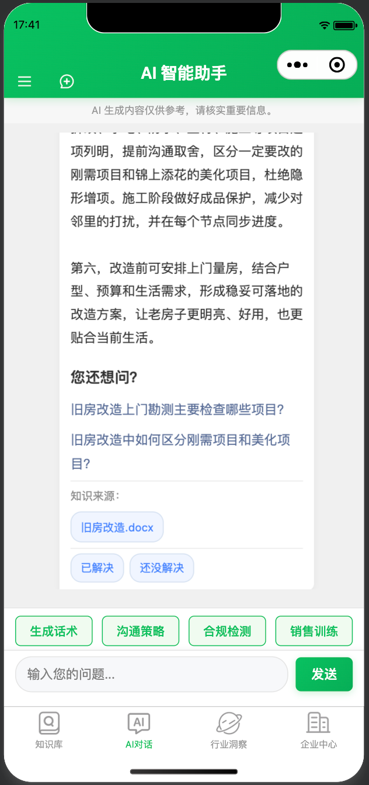

**Industry Insights**

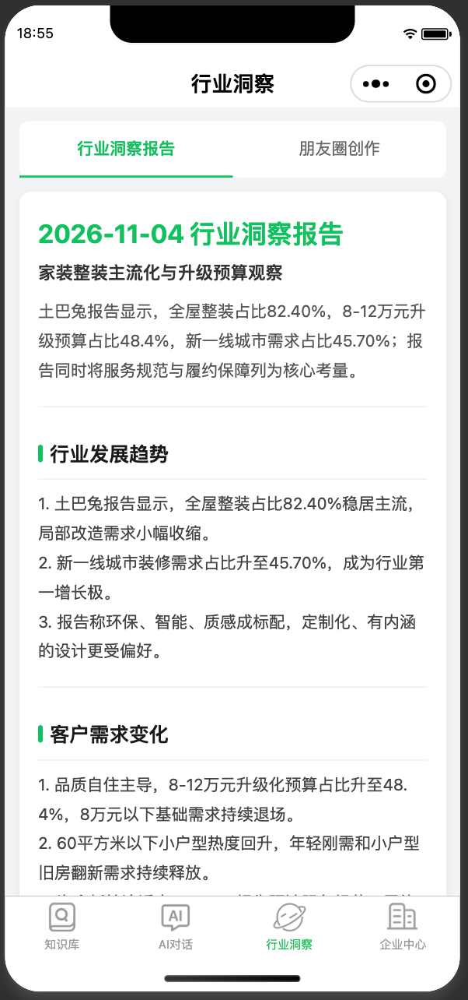

**Public Content Creation · 推荐选题**

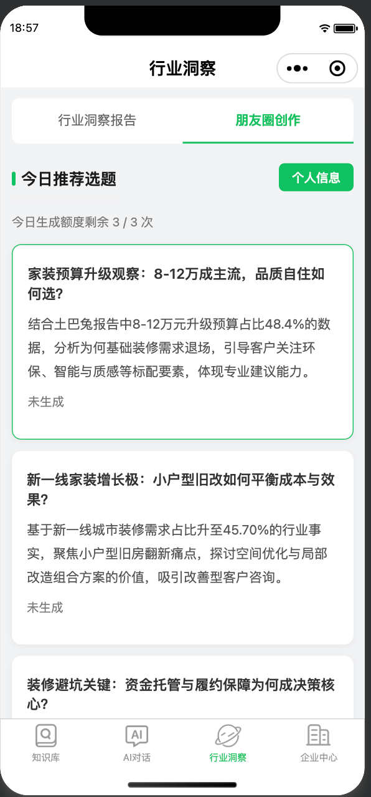

查看登录入口与企业资料管理

**Product Entry · 登录入口**

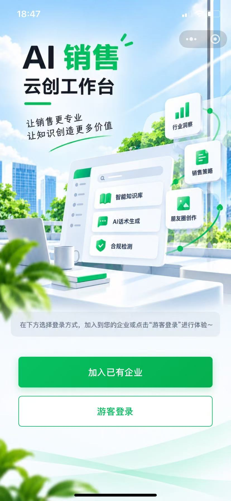

**Enterprise Knowledge Management**

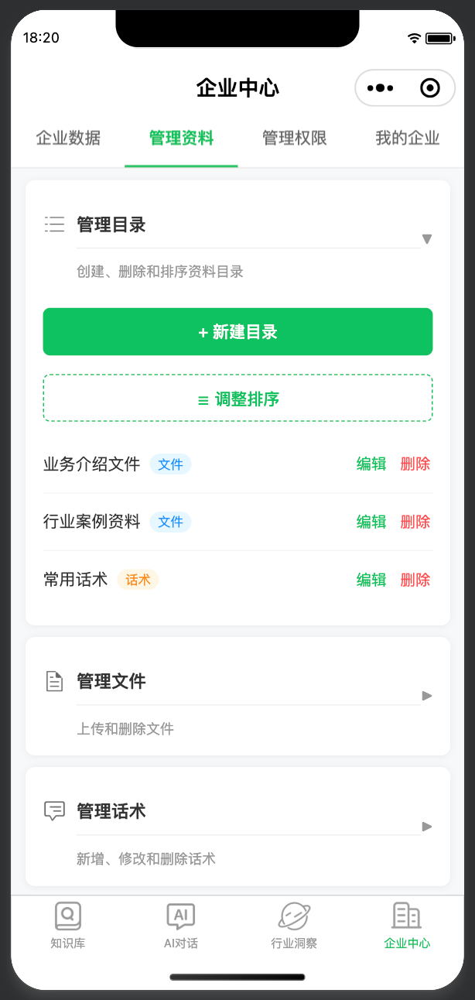

### Platform Admin

展示租户管理及租户级配置；截图中的标识和配置值已遮挡，AI 模板内容保持折叠。

Tenant Management

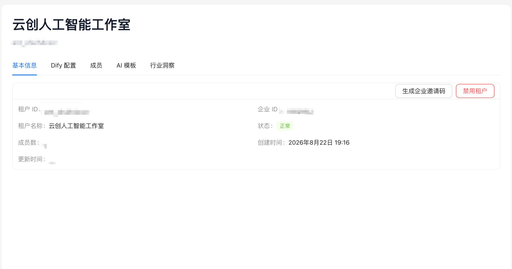

Dify Configuration

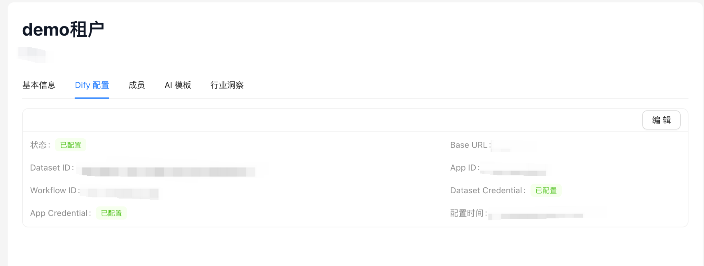

AI Template Management

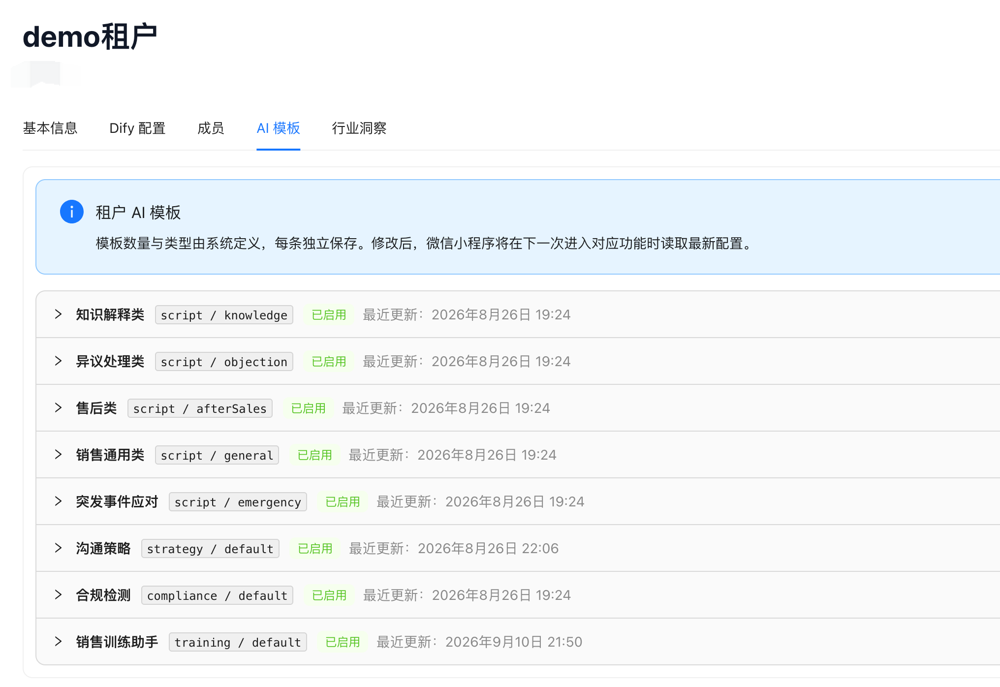

Industry Insights Configuration

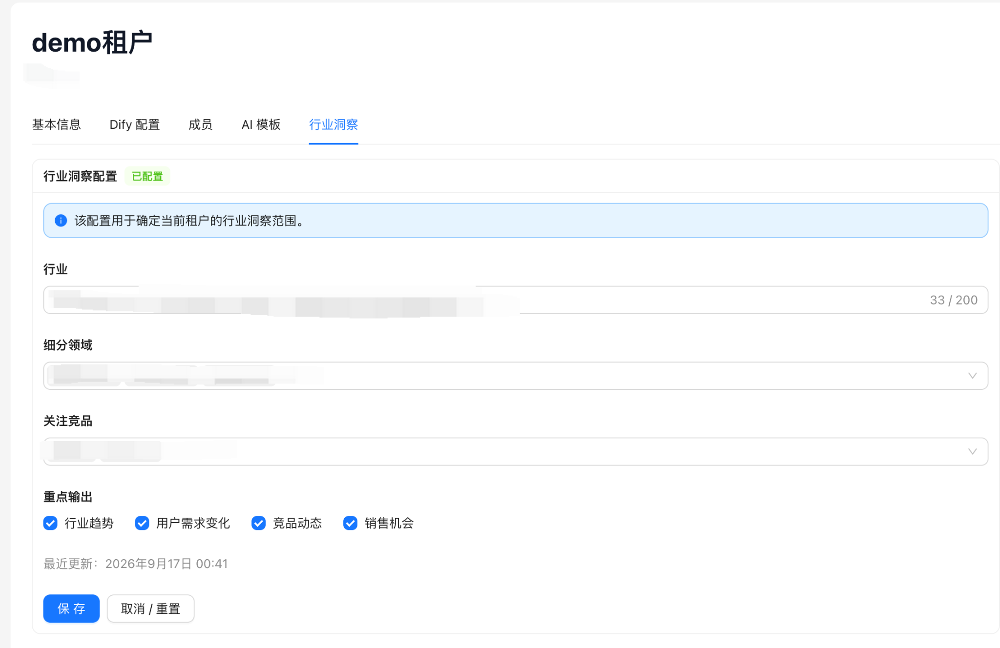

### Enterprise Analytics

企业数据概览、AI 使用与成本、知识效果和团队动态。图中数值为截图时的界面数据，不作为产品效果或规模指标。

Enterprise Data Overview & AI Cost

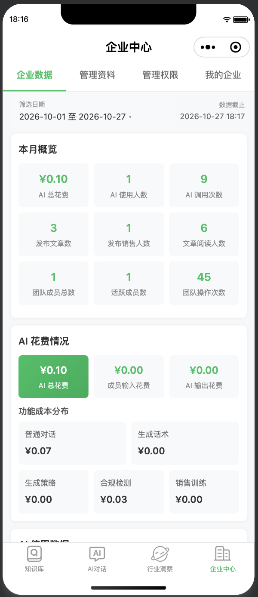

AI Usage Analytics

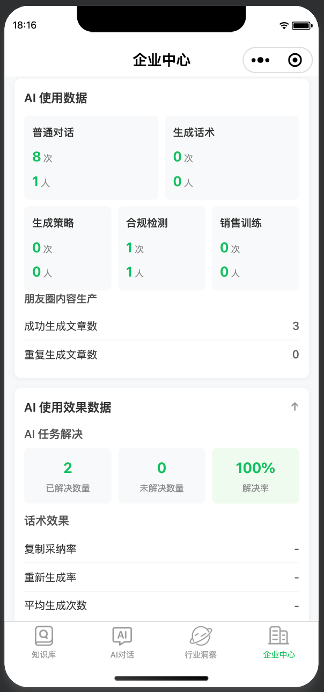

Knowledge Effectiveness & Team Activity

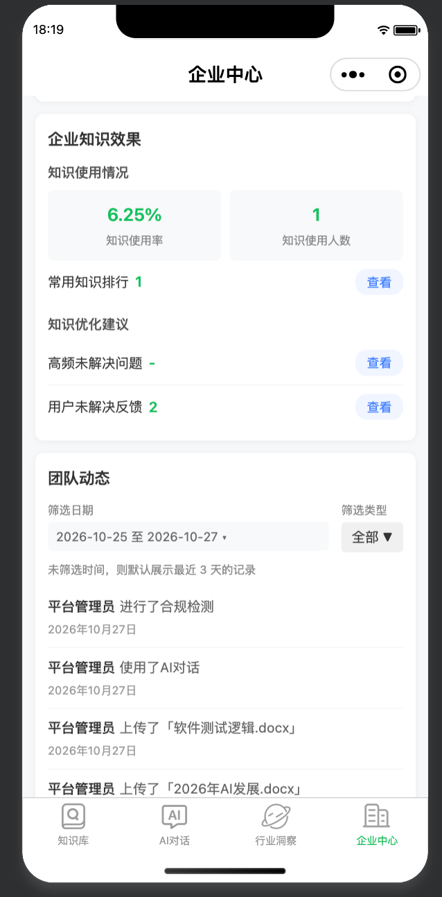

## 07. Development & Contributions

项目由独立开发者主导完成从 0 到 1 的落地，覆盖产品设计、前后端开发、AI 能力集成、基础设施部署和测试验证。

AI 工具参与方案分析与代码执行：

- **GPT**：产品方案拆解、技术方案设计、工程问题分析。
- **Codex**：Platform Admin 开发及代码任务执行。
- **WeChat Developer Tools Agent**：微信小程序开发及代码任务执行。

开发者负责业务目标、方案取舍、系统集成与结果验收。

## 08. Project Status

产品核心业务及多租户基础能力已完成从 0 到 1 的落地：

- **Stage9**：已完成从行业洞察、内容生成与发布到企业分析的生产闭环。
- **朋友圈分享回流**：完整业务链路已通过生产验收。
- **生产定时任务**：持续运行已通过生产验收。

工程事实按证据区分：源码确认用于说明实现，测试代码用于说明已覆盖的场景，生产验收用于说明实际运行结果。

本仓库仅用于 GitHub Showcase，不包含完整商业产品源码、生产环境配置或敏感数据。

## Engineering Documentation

- [Architecture](docs/architecture/)
- [Architecture Decision Records (ADR)](docs/adr/)
- [Engineering Logs](docs/engineering-log/)
