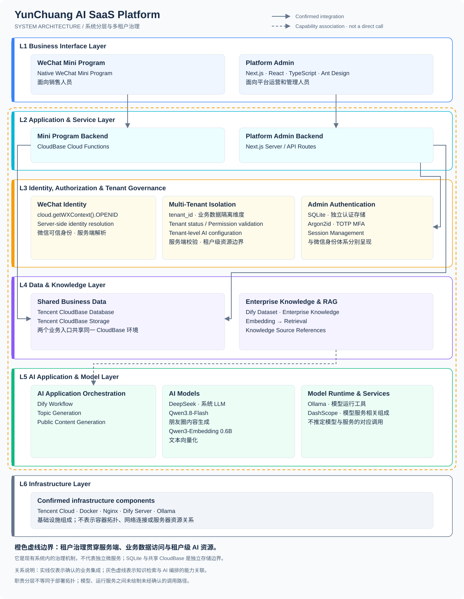

# System Architecture

AI 销售云创工作台由两个业务入口、各自的服务端业务层及共享业务数据环境组成。本组文档解释已确认的系统职责与边界，不包含商业源码、生产配置或部署操作说明。

## 系统组成

| 层次 | 组成与职责 |
| --- | --- |
| 业务入口 | 原生微信小程序面向销售人员；Platform Admin 使用 Next.js、React、TypeScript 和 Ant Design，面向平台运营和管理人员。 |
| 业务服务 | 小程序使用 CloudBase 云函数；管理端使用 Next.js Server / API Routes，分别承接对应入口的业务处理。 |
| 身份与租户治理 | 服务端解析身份、校验租户状态与权限，以 `tenant_id` 作为业务数据隔离维度，并约束租户级 AI 配置的访问。 |
| 共享业务数据 | 两个入口使用同一 Tencent CloudBase 环境中的 Database 与 Storage。管理员认证另有独立 SQLite 存储。 |
| AI 与知识 | Dify Workflow 承担应用编排，Dify Dataset 承担知识库与 RAG 检索链路；LLM 用于生成，Embedding 模型用于文本向量化。 |
| 基础设施 | 腾讯云服务器部署 Docker、Nginx、Dify、Ollama 与 Embedding 模型；此处不推定容器划分或网络拓扑。 |

## 整体架构图

复用仓库现有六层架构图。图中的租户治理边界表示跨层机制，不代表独立微服务；能力关联不等同于已确认的直接调用。

管理员认证与微信身份分别处理，不能由共享 CloudBase 环境推定二者共享身份体系。Dify Dataset 与 CloudBase Database 也具有不同职责，不能视为同一个数据组件。

## 专题导航

- [SaaS 多租户架构](multi-tenant-architecture.md)：租户、成员关系、配置与资源隔离。
- [AI / RAG 架构](ai-rag-architecture.md)：工作流、检索、模型及运行服务职责。
- [数据流与权限边界](data-flow-and-security.md)：服务端身份校验与生成控制原则。

本文依据[项目 README](../../README.md)及现有架构图整理。具体实现细节未在当前 Showcase 仓库核验。
